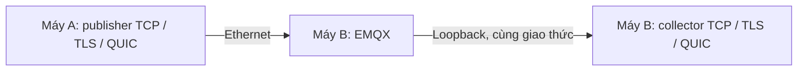

# MQTT Transport Benchmark

Bộ công cụ thực nghiệm so sánh MQTT 3.1.1 qua TCP, TLS 1.3 và QUIC trong điều kiện mạng có độ trễ và mất gói. Dự án đo hai khía cạnh: thời gian thiết lập kết nối MQTT và khả năng chuyển bản tin từ publisher đến collector.

## Mô hình thí nghiệm

Thí nghiệm được thiết kế cho hai máy Linux. Máy A chạy publisher viết bằng C và dùng Linux NetEm để mô phỏng độ trễ hoặc mất gói trên đường gửi. Máy B chạy broker EMQX 5.8.8, collector Python và công cụ bắt gói.

Cả ba phương án dùng chung broker và đổi giao thức ở cả hai chặng: TCP → EMQX → TCP, TLS → EMQX → TLS, QUIC → EMQX → QUIC. Máy A giữ publisher; máy B giữ EMQX và collector. Chặng thứ hai chạy nội bộ máy B (loopback). NetEm vẫn chỉ áp trên cổng ra máy A; không mô phỏng loss/delay trên loopback B.

Cả A và B cần biên dịch client C: collector QUIC gọi engine LSQUIC trên B và dùng timestamp nhận lấy trong C trước khi chuyển qua pipe Python. TCP/TLS collector dùng Paho/OpenSSL. Khác biệt thư viện và xử lý cần ghi vào hạn chế phép so sánh.

## Kịch bản đo

| Kịch bản | Điều kiện mặc định | Chỉ số |
| --- | --- | --- |
| **S1 — Thiết lập kết nối** | Độ trễ mô phỏng 0, 50 và 200 ms | Thời gian publisher tới CONNACK; thời gian collector tới CONNACK/SUBACK ghi riêng, không cộng hai kết nối |
| **S2 — Truyền bản tin khi mất gói** | Mất gói 0%, 1%, 5% và 10%. Mỗi lượt gửi 1.000 bản tin, mỗi bản tin 128 byte, cách nhau 100 ms, ở QoS 0. | Tỷ lệ bản tin đến collector và độ trễ từ publisher đến collector |

Độ trễ S2 được tính từ hai dấu thời gian trên hai máy, nên độ chính xác phụ thuộc vào mức đồng bộ đồng hồ. Chỉ số này bao gồm cả thời gian xử lý tại broker và collector.

## Cấu trúc mã nguồn

| Thư mục | Nội dung |
| --- | --- |
| [`pub/`](pub/) | Publisher TCP/TLS dùng libmosquitto và OpenSSL, client QUIC dùng LSQUIC và BoringSSL |
| [`emqx/`](emqx/) | Cấu hình broker EMQX và mã tạo chứng chỉ thử nghiệm |
| [`collector/`](collector/) | Subscriber TCP/TLS/QUIC cùng giao thức publisher, kiểm tra JSON và ghi CSV |
| [`measure/`](measure/) | Điều phối các lượt đo S1/S2 và tổng hợp kết quả |
| [`dumpcap/`](dumpcap/) | Bắt gói bằng dumpcap và trích xuất dữ liệu bằng tshark |
| [`tcp/`](tcp/) | Publisher và subscriber TCP dùng để kiểm tra chức năng |
| [`tests/`](tests/) | Kiểm thử logic đo và phân tích |

## Trạng thái kiểm chứng

Publisher đã được biên dịch và kiểm tra gửi bản tin thành công qua cả TCP, TLS và QUIC trong môi trường kiểm thử. Đã kiểm tra thêm ba cặp TCP/TCP, TLS/TLS, QUIC/QUIC: mỗi cặp nhận3/3 bản tin128byte hợp lệ; capture NIC và loopback sẵn sàng. Đây là QA phần mềm, không phải kết quả S1/S2 hai máy. Hiệu năng trên hai máy Linux thực và khả năng triển khai trên ESP32 vẫn đang chờ kiểm chứng.
