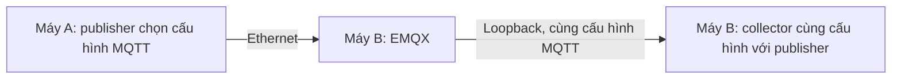

# MQTT Transport Benchmark

Bộ công cụ thực nghiệm so sánh MQTT 3.1.1 theo ba cấu hình: MQTT/TCP không mã hóa, MQTT/TCP + TLS 1.3 và MQTT/QUIC có TLS 1.3 tích hợp. TLS trong cấu hình MQTT/TLS chạy trên TCP; đây là ba cấu hình đo, không phải ba giao thức vận chuyển độc lập. Dự án đo hai khía cạnh: thời gian thiết lập kết nối MQTT và khả năng chuyển bản tin từ publisher đến collector.

## Mô hình thí nghiệm

Thí nghiệm được thiết kế cho hai máy Linux. Máy A chạy publisher viết bằng C và dùng Linux NetEm để mô phỏng độ trễ hoặc mất gói trên đường gửi. Máy B chạy broker EMQX 5.8.8, collector Python và công cụ bắt gói.

Cả ba cấu hình dùng chung một broker EMQX. Hai chặng luôn dùng cùng cấu hình: MQTT/TCP → EMQX → MQTT/TCP; MQTT/TCP + TLS → EMQX → MQTT/TCP + TLS; MQTT/QUIC → EMQX → MQTT/QUIC. Máy A giữ publisher; máy B giữ EMQX và collector. Chặng thứ hai chạy nội bộ máy B (loopback). NetEm vẫn chỉ áp trên cổng ra máy A; không mô phỏng loss/delay trên loopback B.

Cả A và B cần biên dịch client C: collector QUIC gọi engine LSQUIC trên B và dùng timestamp nhận lấy trong C trước khi chuyển qua pipe Python. Collector dùng Paho cho MQTT/TCP và Paho/OpenSSL cho MQTT/TCP + TLS. Khác biệt thư viện và xử lý cần ghi vào hạn chế phép so sánh.

## Ba cấu hình đo và tên trong lệnh

| Tên CLI | Cấu hình thực tế | Kết nối tới EMQX | Vai trò |
| --- | --- | --- | --- |
| `--transport tcp` | MQTT trên TCP, không TLS | TCP1883 | Mốc phụ để quan sát chi phí thêm mã hóa |
| `--transport tls` | MQTT trên TLS1.3 trên TCP | TCP8883 | Đối chứng có mã hóa cho QUIC |
| `--transport quic` | MQTT trên QUIC; QUIC dùng UDP và tích hợp TLS1.3 | UDP14567 | Cấu hình QUIC có mã hóa |

Tên `tls` trong lệnh chỉ là cách gọi ngắn cho **MQTT/TCP + TLS**. Nó không có nghĩa bỏ TCP hoặc chạy một broker TLS riêng. Cùng EMQX mở ba listener trên các cổng trên. So sánh chính là **MQTT/TCP + TLS1.3 với MQTT/QUIC** vì cả hai có mã hóa; MQTT/TCP thuần là mốc bổ sung. S1 và S2 dùng được cho cả ba cấu hình.

## Kịch bản đo

| Kịch bản | Điều kiện mặc định | Chỉ số |
| --- | --- | --- |
| **S1 — Thiết lập kết nối** | Độ trễ mô phỏng 0, 50 và 200 ms | Thời gian publisher tới CONNACK; thời gian collector tới CONNACK/SUBACK ghi riêng, không cộng hai kết nối |
| **S2 — Truyền bản tin khi mất gói** | Mất gói 0%, 1%, 5% và 10%. Mỗi lượt gửi 1.000 bản tin, mỗi bản tin 128 byte, cách nhau 100 ms, ở QoS 0. | Tỷ lệ bản tin đến collector và độ trễ từ publisher đến collector |

Độ trễ S2 được tính từ hai dấu thời gian trên hai máy, nên độ chính xác phụ thuộc vào mức đồng bộ đồng hồ. Chỉ số này bao gồm cả thời gian xử lý tại broker và collector.

## Cấu trúc mã nguồn

| Thư mục | Vai trò và các file chính |
| --- | --- |
| [`pub/`](pub/) | Chương trình gửi dùng cho **cả S1 và S2**. `tcp_pub.c` gửi MQTT/TCP thuần hoặc MQTT/TCP + TLS; `quic_client.c` xử lý QUIC; `bench-pub` chọn cấu hình đo. `bench-sub` hỗ trợ thử nhận thủ công. |
| [`emqx/`](emqx/) | **Broker duy nhất là EMQX**. `compose.yaml` khởi động broker; `emqx.conf` bật MQTT/TCP1883, MQTT/TCP + TLS8883 và MQTT/QUIC UDP14567; `make_certs.py` tạo chứng chỉ lab. |
| [`collector/`](collector/) | Subscriber chính thức trên B, **dùng cùng cấu hình với publisher**. `collector.py` nhận MQTT/TCP hoặc MQTT/TCP + TLS hoặc gọi `quic_receiver.py` và engine C cho QUIC; kiểm JSON128B, ghi giờ nhận và CSV. |
| [`measure/`](measure/) | `run.py` trên A tổ chức lượt đo; `server.py` trên B chuẩn bị capture và collector; `analyze.py` tính S1/S2; `common.py` chứa kiểm tra và metadata dùng chung. |
| [`dumpcap/`](dumpcap/) | `capture.py` gọi dumpcap ghi cả Ethernet B và loopback; `export.py` gọi tshark. Hai chặng xuất bảng frame riêng; pcapng mở trong Wireshark. |
| [`tcp/`](tcp/) | `pub.py` và `sub.py` chỉ thử câu hello với EMQX. **Bộ đo TCP S1/S2 nằm ở `pub/tcp_pub.c`**, không dùng hai tiện ích hello thay phép đo. |
| [`tests/`](tests/) | Kiểm thử thuật toán: timestamp, phân vị, trùng/muộn, đồng hồ và trạng thái listener. Fixture kiểm thử không phải kết quả hiệu năng. |

## Vì sao dùng libmosquitto và LSQUIC

Hai tên này thuộc hai phần khác nhau của chương trình:

- **libmosquitto** là thư viện **MQTT client viết bằng C**. Publisher MQTT/TCP thuần và MQTT/TCP + TLS dùng nó để tạo phiên MQTT, gửi CONNECT/PUBLISH và nhận CONNACK. Nhánh MQTT/TCP + TLS dùng thêm OpenSSL để mã hóa kết nối TCP. Đây là lựa chọn triển khai để tái sử dụng xử lý MQTT và đặt mốc đo tại callback, thay vì tự viết lại toàn bộ MQTT/TCP. Broker vẫn là EMQX; không khởi động Mosquitto broker.
- **LSQUIC** là engine **QUIC**. Code C của nhóm đóng gói MQTT CONNECT/PUBLISH/SUBSCRIBE rồi đưa vào stream; LSQUIC xử lý kết nối QUIC, stream, ACK và khôi phục mất gói. Nhánh này dùng BoringSSL cho TLS1.3 bên trong QUIC. LSQUIC không thay EMQX và không tự tạo payload MQTT.
- **Paho** là thư viện MQTT phía collector TCP thuần hoặc TCP + TLS bằng Python. Collector QUIC gọi engine C và lấy timestamp nhận ngay trong C trước khi chuyển dữ liệu qua pipe Python.
- **mosquitto_pub / mosquitto_sub** là tiện ích client dòng lệnh cho kiểm tra thủ công; chúng khác chương trình Mosquitto broker. Các lệnh này vẫn kết nối tới EMQX.

So sánh vì vậy có cả khác biệt thư viện và đường xử lý: libmosquitto/OpenSSL, Paho/OpenSSL và LSQUIC/BoringSSL. Cần ghi chúng vào cấu hình và hạn chế, không quy mọi chênh lệch thời gian chỉ cho TCP hay QUIC.

## Đối chiếu slide của nhóm

Đã đối chiếu bản `QUIC QUIC QUIC.pptx` có trong dữ liệu dự án:

| Slide | Nội dung tài liệu | Quan hệ với code |
| --- | --- | --- |
| 54 | Tạo tải bằng emqtt_bench --quic **hoặc client của nhóm** | Bản này theo nhánh client C của nhóm. Không tuyên bố emqtt_bench là công cụ duy nhất đã chốt. |
| 56 | Đề xuất thư viện LSQUIC | Cơ sở chọn engine QUIC cho nhánh Linux/Pi. |
| 65 | Thử định dạng bản tin bằng Mosquitto + script trên EMQX | Có căn cứ dùng công cụ client Mosquitto. Slide này **không bắt buộc libmosquitto cho toàn bộ bộ đo C**; lựa chọn thư viện C là quyết định triển khai. |
| 80 | LSQUIC dùng BoringSSL, TCP dùng OpenSSL; collector TCP cố định | Xác nhận hai bộ thư viện khác nhau phải ghi trong hạn chế. Mô hình collector cố định là phương án cũ. |
| 85 | Client C MQTT3.1.1 dùng LSQUIC tới EMQX UDP14567 | Cơ sở phân tầng MQTT do ứng dụng tạo, QUIC do LSQUIC xử lý. |
| 90 và 97 | Publisher và subscriber QUIC dùng các kết nối QUIC riêng tới EMQX | Có mô tả cả pub và sub QUIC. Bản cập nhật hiện dùng collector cùng transport theo yêu cầu người dùng. |

`Slide tổng mqtt quic.pptx`, slide15, cũng liệt kê emqtt_bench ở phần công cụ. Hai bộ slide chứa các mức mô tả và phương án khác nhau; không xem mỗi công cụ được liệt kê là một yêu cầu bắt buộc đồng thời. Bản hiện tại giữ A=publisher, B=EMQX+collector và đổi giao thức cả hai chặng theo quyết định mới của người dùng.

Tham khảo API chính thức: [libmosquitto client library](https://mosquitto.org/api/files/mosquitto-h.html), [LSQUIC v4.6.3](https://github.com/litespeedtech/lsquic/tree/v4.6.3). Bản PowerPoint nguồn được giữ nguyên trong dữ liệu dự án, không đưa lên repository mã.

## Trạng thái kiểm chứng

Publisher đã được biên dịch và kiểm tra gửi bản tin thành công qua cả TCP, TLS và QUIC trong môi trường kiểm thử. Đã kiểm tra thêm ba cặp TCP/TCP, (TCP+TLS)/(TCP+TLS), QUIC/QUIC: mỗi cặp nhận3/3 bản tin128byte hợp lệ; capture NIC và loopback sẵn sàng. Đây là QA phần mềm, không phải kết quả S1/S2 hai máy. Hiệu năng trên hai máy Linux thực và khả năng triển khai trên ESP32 vẫn đang chờ kiểm chứng.
